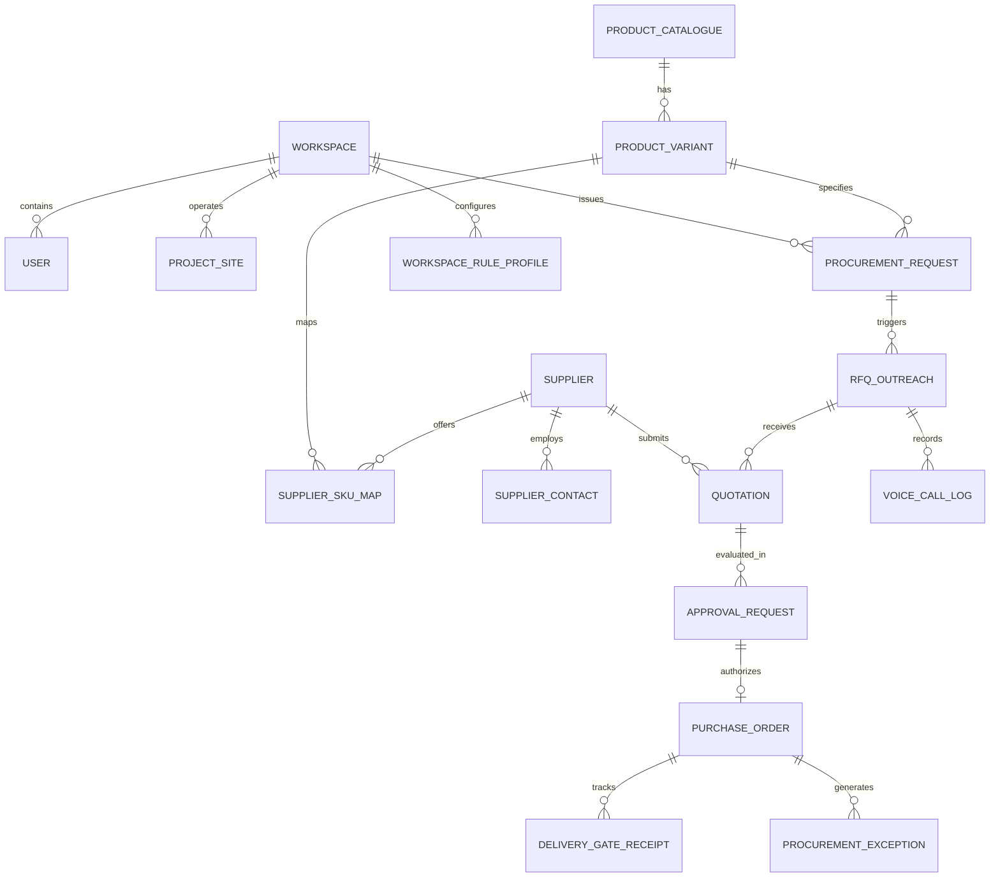

# Kovok — Current State Technical & Domain Audit

**Document Status:** Final Audit  
**Author:** Lead Software Engineer  
**Date:** October 30, 2026  
**Target Environment:** Production Construction Procurement (Indian Market)

---

## 1. Executive Summary & Audit Scope

Kovok is designed as an AI-powered procurement operations platform for construction materials in India, initially focused on **TMT Steel** and **Cement**. It operates across two primary workflows:
1. **Connected Procurement:** Integrating with buyer ERPs, inventory systems, or accounting tools (e.g., ERPNext, TallyPrime, Zoho).
2. **Quick Source:** Guiding buyers without integrated procurement software through natural-language/voice specification, supplier matching, automated voice quoting via Sarvam AI, structured commercial comparison, explicit gated buyer approvals, and delivery/receipt tracking.

### Core Domain Invariant
> **Strict Business Rule:** The buyer pays the supplier directly. Kovok is an operations and intelligence layer; it does not escrow or hold buyer funds, and it **must never place an order or commit commercial terms without verified, explicit buyer authorization**.

### Current Baseline
The audited repository contains an HTML/CSS/JS frontend concept prototype (`index.html`), screen specifications (`UI_SCREEN_SPEC.md`), business onboarding guidelines (`ONBOARDING_QUESTIONS.md`), UI screenshots, and a Linux-based Playwright smoke test (`check_ui.py`).

While the prototype delivers a clean, restrained, table-first design inspired by industrial procurement systems (ERPNext, SAP Ariba, Procore, JSW One MSME), **it is strictly a client-side mockup**. All data is hardcoded in memory, no server or database exists, interactive forms do not persist, voice integrations are static buttons, and no security or multi-tenancy controls are implemented.

---

## 2. Codebase Structure & Source Inventory

```
Kovok_Construction_UI_Premium/
├── docs/                                # Production architecture & implementation plans
│   ├── CURRENT_STATE_AUDIT.md           # This audit document
│   ├── ARCHITECTURE_DECISIONS.md        # Technical architecture specifications
│   └── IMPLEMENTATION_PLAN.md           # Phased roadmap and acceptance criteria
├── .env.example                         # Environment configuration template
├── Kovok_Construction_UI_Premium/        # Original prototype package
│   ├── index.html                       # Single-file HTML/CSS/JS prototype (83,949 bytes, 115 lines)
│   ├── UI_SCREEN_SPEC.md                # UI design direction and screen specs (7,099 bytes)
│   ├── ONBOARDING_QUESTIONS.md          # Progressive onboarding questionnaire (9,897 bytes)
│   ├── README.md                        # Prototype documentation and run instructions (2,429 bytes)
│   ├── preview_gallery.html             # Gallery page referencing prototype screenshots (4,428 bytes)
│   ├── check_ui.py                      # Playwright UI verification script (1,957 bytes)
│   └── preview_*.png                    # 11 full-page screenshot previews
```

### File-by-File Technical Inspection

| File | Purpose | Tech Stack | Production Readiness | Gaps Identified |
| :--- | :--- | :--- | :--- | :--- |
| `index.html` | Core UI prototype | Vanilla HTML5, CSS3, ES6 JS | **Concept Prototype Only** | Monolithic single file; all logic in `document.addEventListener`; zero backend communication; hardcoded data. |
| `check_ui.py` | UI test script | Python 3, Playwright | **Non-portable Script** | Hardcoded to Linux path `/mnt/data/Kovok_Construction_UI_Premium` and `/usr/bin/chromium`; fails on Windows/Mac without local Chromium configuration. |
| `UI_SCREEN_SPEC.md` | Specification | Markdown | **High Value Reference** | Lacks API contracts, HTTP response schemas, and error state specifications. |
| `ONBOARDING_QUESTIONS.md` | Onboarding spec | Markdown | **High Value Reference** | Lacks formal JSON schema definitions for workspace rule generation. |
| `preview_gallery.html` | Visual asset | Static HTML/CSS | **Documentation Only** | Visual artifact showcasing pre-rendered PNGs. |

---

## 3. Comprehensive Sample Data Audit

Every data structure rendered in the UI is hardcoded in memory within `index.html`. Below is the complete catalog of hardcoded fixtures:

### 3.1 Client State Object (`index.html:L61`)
```javascript
const state = {
  page: 'overview',
  requestStep: 0,
  request: {
    mode: 'standalone',
    category: 'tmt',
    description: '',
    grade: 'Fe 550D',
    diameter: '12',
    brand: 'Open to approved brands',
    quantity: '20',
    unit: 'tonnes',
    site: 'Site A — Gurugram',
    pin: '122018',
    date: '2026-11-02',
    delivery: 'Delivered at site',
    budget: '',
    suppliers: '3',
    notes: ''
  },
  setupStep: 0,
  setup: {
    businessType: 'Contractor / Builder',
    company: 'Concrete & Co.',
    sites: '2',
    categories: ['TMT Steel','Cement'],
    source: 'Site engineer / project manager',
    frequency: 'Weekly',
    supplierList: 'Existing contacts + discover new',
    decision: 'Total delivered cost and delivery reliability',
    approval: 'Owner / project manager',
    orderValue: '₹50,000+',
    language: 'Hindi + English',
    systems: 'Excel / WhatsApp',
    retries: '2',
    substitutions: 'Only after approval'
  }
};
```
* **Audit Finding:** The workspace identity ("Concrete & Co.", "Delhi NCR · 2 sites"), user profile ("Shiwang Gupta, Workspace admin"), and pre-filled form fields are permanently baked into the client state. Any change made during a session is lost on browser refresh.

### 3.2 Navigation Counter Badges (`index.html:L42, L43, L45`)
* Requests badge: `<span class="count">6</span>`
* Quotations badge: `<span class="count">3</span>`
* Exceptions badge: `<span class="count">2</span>`
* **Audit Finding:** Badges are static hardcoded HTML spans; they do not calculate counts from active database records.

### 3.3 Procurement Requests Fixture (`index.html:L68-75`)
```javascript
const requests = [
  ['KOV-1028','TMT steel · Fe 550D · 12 mm','20 tonnes · Gurugram','Nov 2, 2026',status('Quotes ready','blue'),'3 offers'],
  ['KOV-1027','OPC 53 cement · 50 kg','300 bags · Dwarka','Oct 30, 2026',status('Awaiting approval','amber'),'2 offers'],
  ['KOV-1026','TMT steel · Fe 500D · 16 mm','8 tonnes · Noida','Oct 31, 2026',status('Supplier call pending','amber'),'1 of 3'],
  ['KOV-1025','PPC cement · 50 kg','500 bags · Gurugram','Nov 1, 2026',status('Order confirmed','green'),'Selected supplier'],
  ['KOV-1024','M-sand · Zone II','2 truckloads · Faridabad','Oct 29, 2026',status('Needs clarification','red'),'Quantity/unit'],
  ['KOV-1023','TMT steel · Fe 550D · 10 mm','5 tonnes · Delhi','Oct 28, 2026',status('Delivered · inspect','blue'),'Receipt pending']
];
```
* **Audit Finding:** Represented as untyped string arrays rather than normalized relational objects. Modifying the requests array does not propagate relational updates to quotations, orders, or exceptions.

### 3.4 Overview Metrics & Attention Queue (`index.html:L77-79`)
* Four metric cards hardcoded: `6` Open requests, `3` Quotes ready, `2` Orders at risk, `1` Awaiting approval.
* Needs Attention queue hardcoded:
  - Supplier shortfall: `KOV-1028 · 8 of 20 tonnes unconfirmed`
  - Delivery date changed: `KOV-1025 · ETA moved by one day`
* Next deliveries hardcoded:
  - `Sunrise Cement Traders · Today, 4:30 PM`
  - `Shakti Steel & Co. · Tomorrow, 9:00 AM`

### 3.5 Quotation Comparison Matrix (`index.html:L81`)
* Scope locked to a single static request: `KOV-1028 · TMT Fe 550D · 12 mm`.
* Fixed offers:
  1. **Shakti Steel & Co.:** Subtotal ₹9,80,000, Freight+Unloading ₹32,000, Total ₹10,12,000 (₹50,600/t), 20t available, ETA 1 Nov, Valid 24h.
  2. **Northline Metals:** Subtotal ₹9,86,000, Freight+Unloading ₹32,000, Total ₹10,18,000 (₹50,900/t), 20t available, ETA 2 Nov, Valid 12h.
  3. **Metro Build Supply:** Subtotal ₹9,96,000, Freight+Unloading: `Not confirmed`, Total: `—`, Status: `Incomplete`.
* Notice: Hardcoded banner warning that Metro Build Supply is non-comparable due to missing freight/unloading.

### 3.6 Orders & Deliveries Table (`index.html:L82`)
* Static array of 3 purchase orders:
  - `PO-0261`: 20t TMT Fe 550D from Shakti Steel, ETA Tomorrow 9:00 AM, `Confirmed`.
  - `PO-0260`: 500 bags PPC from Sunrise Cement, ETA Today 4:30 PM, `Dispatch confirmed`.
  - `PO-0259`: 8t TMT Fe 500D from Northline Metals, `At risk` (Recovery open).

### 3.7 Exceptions Queue (`index.html:L83`)
* Fixed metrics: `2` Open, `1` Awaiting supplier, `1` Awaiting buyer, `4` Closed today.
* Static items:
  - `EX-008`: Supplier shortfall on PO-0259 (8t not confirmed).
  - `EX-007`: ETA changed on PO-0260 (moved by 1 day).
  - `EX-006`: Incomplete quote on KOV-1028 (unloading charge missing).

### 3.8 Product Catalogue Table (`index.html:L84-85`)
* Static array of 6 catalogue items:
  - `TMT Steel · Fe 550D` (12 mm, Verified, 2 supplier mappings)
  - `Cement · OPC 53` (50 kg bag, Verified, 4 supplier mappings)
  - `Cement · PPC` (50 kg bag, Partially verified, 3 supplier mappings)
  - `RMC · M25` (Grade & pour-slot configured, Schema only)
  - `M-sand · Zone II` (Grading & delivered quantity required, Provisional)
  - `Waterproofing membrane` (Needs review)

### 3.9 Supplier Directory (`index.html:L86`)
* 4 hardcoded suppliers:
  - `Shakti Steel & Co.` (Gurugram 122001, Hindi/English, 12 verified orders, Preferred)
  - `Sunrise Cement Traders` (Dwarka 110075, Hindi/English, 21 verified orders, Active)
  - `Northline Metals` (Delhi NCR, Hindi/English, 4 orders, Active)
  - `Metro Build Supply` (Faridabad 121001, Hindi, 0 orders, New)

### 3.10 Integrations & Settings (`index.html:L87-88`)
* Hardcoded connectors: CSV/Excel (`Available in prototype`), ERPNext (`Not connected`), TallyPrime (`Planned`).
* Settings form options are plain HTML elements; saving invokes an alert modal stating "This prototype has no persistent backend."

---

## 4. UI Elements: Functional vs Non-Functional Audit

| Component / Screen | Element | Expected Behavior | Current Prototype Status | Remediation Required |
| :--- | :--- | :--- | :--- | :--- |
| **Global Topbar** | Search Input (`#globalSearch`) | Server-side / fuzzy entity search across requests, quotes, suppliers, and items. | **Fake Navigation:** Checks keyword substring (`quote`, `supplier`, `catalog`) and redirects page tab with a mock toast. | Implement PostgreSQL `pg_trgm` full-text search API endpoint `/api/v1/search`. |
| **Global Topbar** | Help Button (`#helpBtn`) | Contextual help documentation / support drawer. | **Non-functional:** Emits a static toast message. | Integrate help drawer with guided workflow tips. |
| **Global Topbar** | `+ New Request` Button | Opens interactive request wizard. | **Partial:** Opens modal wizard, captures input in memory, but submittal only triggers a toast and resets on reload. | Connect to backend `POST /api/v1/requests` with schema validation. |
| **Requests Screen** | Filter Dropdown (`#reqFilter`) | Filters table rows by status. | **Broken:** Element exists in DOM, but no `change` event listener is attached. Selecting an option does nothing. | Wire reactive filter state to paginated API query params (`?status=...`). |
| **Requests Screen** | Import Button | Opens CSV/Excel file upload wizard. | **Placeholder:** Displays an informational modal with mock text. | Implement multipart upload API with preview & column mapping. |
| **Requests Screen** | Row Action `Open ->` | Opens full procurement request details. | **Placeholder:** Opens static `infoModal('open-request')`. | Create full-page / drawer view with quote history, audit timeline, and live status. |
| **Quotations Screen** | Table Actions (`Clarify`, `Review`) | Initiates supplier clarification call/message; prepares approval packet. | **Placeholder:** Triggers static mock modal or toast. | Implement Sarvam voice clarification dispatch and approval workflow triggers. |
| **Quotations Screen** | `Select for approval` | Submits selected quote to authorized buyer for formal signoff. | **Placeholder:** Displays `approve-quote` static modal. | Create formal Approval entity with versioned quote snapshot and cryptographic/session token. |
| **Orders Screen** | Export Button | Downloads CSV/PDF of active purchase orders. | **Placeholder:** Displays static `infoModal('export-orders')`. | Implement streaming CSV/PDF generation endpoint. |
| **Orders Screen** | Filter Dropdown | Filters orders by status (`At risk`, `Awaiting receipt`). | **Broken:** No event listener attached. | Implement reactive status filtering. |
| **Product Catalogue** | Search & Filters | Searches items by IS standard, brand, SKU, and category. | **Broken:** Input and selects are un-wired. | Connect to catalogue query API with attribute facet filtering. |
| **Product Catalogue** | `Add product` Form | Creates new canonical or provisional product. | **Mock Only:** Saves nothing; only displays a toast. | Connect to `POST /api/v1/products` with duplicate checking and provisional flags. |
| **Suppliers Screen** | Search & Filter Inputs | Filters suppliers by PIN code, material, rating. | **Broken:** No event listeners attached. | Connect to supplier query API with spatial / PIN code serviceability filter. |
| **Suppliers Screen** | `Add supplier` Button | Opens form to create supplier record. | **Placeholder:** Opens static info modal. | Create interactive multi-step supplier onboarding form. |
| **Integrations Screen** | Connector Action Buttons | Initiates OAuth or API token configuration for ERPNext. | **Placeholder:** Displays static info modal stating connector is not implemented. | Build credential storage, sync configuration, and field mapping engine. |
| **Settings Screen** | `Save` Button | Persists tenant procurement policy and calling rules. | **Placeholder:** Opens modal stating "This prototype has no persistent backend." | Wire to `PUT /api/v1/workspaces/:id/settings`. |
| **New Request Wizard** | Voice Button (`voice-demo`) | Activates microphone or speech input via Sarvam AI. | **Placeholder:** Shows static modal stating Sarvam is not connected. | Integrate browser Web Audio API / MediaRecorder and Sarvam STT API. |
| **Workspace Setup Wizard**| 6-step Onboarding | Configures rules, material policies, and call thresholds. | **Mock Only:** Generates client preview; clicking "Approve" shows a toast and discards data on refresh. | Store workspace configuration profile in PostgreSQL. |

---

## 5. Missing Backend, Database & Infrastructure

The application currently lacks all foundational production backend capabilities:

```
Current State:                           Target Production Architecture:
┌──────────────────────────────┐        ┌──────────────────────────────┐
│                              │        │      React / Next.js UI      │
│     Browser (index.html)     │        └──────────────┬───────────────┘
│  - In-memory state           │                       │ REST / WebSocket
│  - Hardcoded JSON fixtures   │        ┌──────────────▼───────────────┐
│  - No authentication         │        │    TypeScript API Layer      │
│  - No external communication │        │ (Auth, RBAC, Domain Engines) │
│                              │        └──────┬───────┬───────┬───────┘
└──────────────────────────────┘               │       │       │
                                        ┌──────▼──┐ ┌──▼────┐ ┌▼──────────────┐
                                        │Postgres │ │Redis  │ │Sarvam AI Voice│
                                        │Database │ │Queue  │ │Webhooks & APIs│
                                        └─────────┘ └───────┘ └───────────────┘
```

1. **Server-Side API Layer:** No HTTP server exists to process requests, perform input validation, enforce business rules, or coordinate asynchronous workflows.
2. **Relational Database & Migrations:** No relational data persistence (PostgreSQL). Schema migrations, foreign key integrity, ACID transactions, and indexing are absent.
3. **Authentication & Multi-Tenancy:**
   - No user authentication (passwords, OTP, JWT, session cookies).
   - No Role-Based Access Control (RBAC): Owner, Procurement Officer, Project Manager, Site Engineer, Storekeeper.
   - No multi-tenant data isolation: All workspaces must be partitioned by `workspace_id`.
4. **Asynchronous Background Processing & Queues:**
   - Sourcing outreach, voice agent calls, webhook retries, and scheduled deadline checks require a background queue (e.g., BullMQ + Redis).
5. **Object Storage:**
   - No storage mechanism for voice call recordings, raw audio, weighment slips, delivery challans, mill test certificates (MTC), or invoice photos.

---

## 6. Required Domain Entities & Schema Specifications

To handle real Indian construction procurement, the system must define normalized relational schemas representing the following business entities:



### 6.1 Product Catalogue & Indian Material Standards
* **TMT Reinforcement Steel:**
  - Standard: **IS 1786:2008** (High strength deformed steel bars and wires for concrete reinforcement).
  - Grades: `Fe 415`, `Fe 415D`, `Fe 500`, `Fe 500D`, `Fe 550`, `Fe 550D`, `Fe 600`, `Fe 650`. ("D" designates higher ductility, mandatory for seismic zones III, IV, V).
  - Standard Diameters: `8 mm, 10 mm, 12 mm, 16 mm, 20 mm, 25 mm, 28 mm, 32 mm, 36 mm, 40 mm`.
  - Nominal Mass conversion verification (IS 1786 Table 1: kg/meter tolerances).
  - Manufacturer classification: Primary integrated steel plants (Tata Tiscon, JSW Neosteel, SAIL, Jindal Panther) vs Secondary induction furnace re-rollers.
  - Quality documents: Mandatory Mill Test Certificate (MTC) with heat number matching.
* **Cement:**
  - Standards:
    - **IS 269:2015:** Ordinary Portland Cement (OPC 33, OPC 43, OPC 53).
    - **IS 1489 (Part 1):2015:** Portland Pozzolana Cement (PPC - flyash based).
    - **IS 1489 (Part 2):2015:** Portland Pozzolana Cement (PPC - calcined clay based).
    - **IS 455:2015:** Portland Slag Cement (PSC).
    - **IS 16415:2015:** Composite Cement.
  - Packaging: Standard 50 kg HDPE/paper bags or bulk tankers (for RMC batching plants).
  - Freshness / Batch control: Cement loses 20–50% compressive strength after 3 months; manufacturing week/month is a mandatory quality attribute.

### 6.2 Supplier Directory & Calling Governance
* Legal & Commercial Attributes: Legal Entity Name, Trade Name, GSTIN (15-digit Indian GST number with state code validation), PAN, Registered Address, Yard/Godown Address, Geolocation (lat/long) for delivery radius calculation.
* Operational Attributes: Serviceable PIN codes, Material capabilities (brands stocked, secondary vs primary steel), Verified calling phone numbers (E.164 format: `+91XXXXXXXXXX`), Authorized contact persons.
* Voice Calling Rules: Permitted calling windows (default 10:00 AM – 6:00 PM IST weekdays), Language preference (Hindi, English, Hinglish), Max retry limit per RFQ, Minimum cooling-off period between calls.

### 6.3 Quotations & Deterministic Delivered-Cost Calculation
Quotations must normalize Indian commercial pricing terms to ensure strict comparability:
$$\text{Delivered Total} = (\text{Base Price} - \text{Cash/Trade Discount}) + \text{GST} + \text{Freight} + \text{Loading} + \text{Unloading} + \text{Transit Insurance} + \text{Other Levies}$$
* **GST Rates:**
  - TMT Steel: **18% GST** (HSN 7214).
  - Cement: **28% GST** (HSN 2523).
* **Comparability Rules:**
  - An offer is classified as `Comparable` only if all cost components (material, GST, freight to site, and unloading responsibility) are explicitly confirmed.
  - If freight or unloading is "To be billed actuals" or unconfirmed, mark offer as `Non-comparable (Incomplete)` and require clarification before recommendation.

### 6.4 Approval Hierarchy & Anti-Duplicate Order Gates
* **Strict Gate:** An order is created **only** when an authorized user approves a version-locked quotation.
* **Approval Entity:** Records `request_id`, `quotation_id`, `approver_user_id`, `approved_amount`, `commercial_snapshot_hash`, `timestamp`, and `ip_address`.
* **Idempotency Key:** Every order generation requires a deterministic idempotency key `order_create_<quotation_id>_<version>` to prevent duplicate purchase orders resulting from network timeouts or double submissions.

### 6.5 Orders, Delivery & Gate Receipts
* **Purchase Order (PO):** Retains immutable approved terms, payment milestone schedule, delivery window, and site contact.
* **Dispatch & Transit:** Tracks truck number, driver mobile, e-Way Bill number, and dispatch timestamp.
* **Gate Receiving (GRN):** Physical verification at construction site:
  - Weight verification (Weighbridge gross minus tare slip).
  - Bag count for cement.
  - Inspection for rust/damage/caking.
  - Physical delivery challan and invoice matching.

### 6.6 Exceptions & Recovery State Machine
* Exception Types: `Ambiguous Specification`, `No Supplier Answer`, `Supplier Shortfall (Partial Quantity)`, `Price Mismatch`, `Delivery Delay / Rescheduled ETA`, `Transit Damage / Damaged Bags`, `Weighbridge Shortage`, `Invoice/PO Mismatch`.
* State Lifecycle: `Detected` $\rightarrow$ `Investigating` $\rightarrow$ `Options Prepared` $\rightarrow$ `Buyer Authorization Required` $\rightarrow$ `Resolved` $\rightarrow$ `Closed (Evidence-backed)`.

---

## 7. Sarvam AI Voice Agent Integration Requirements

Kovok automates supplier outreach via voice calls powered by Sarvam AI. The audit reveals the following critical integration requirements:

```
┌────────────────┐     1. Initiate Call (Webhook URL, Prompt, Voice)     ┌────────────────┐
│  Kovok Worker  ├───────────────────────────────────────────────────────►│  Sarvam Voice   │
│  (BullMQ)      │◄───────────────────────────────────────────────────────┤     Agent      │
└────────────────┘     2. Call Queued / Session ID                        └───────┬────────┘
                                                                                  │ 3. Telephony
                                                                                  ▼
┌────────────────┐     4. Call Status & Transcript Webhooks               ┌────────────────┐
│ Kovok Webhook  │◄───────────────────────────────────────────────────────┤ Indian Supplier│
│ Endpoint       │     5. Extracted Structured JSON (Rates, Stock, ETA)   │ (+91 Phone)    │
└───────┬────────┘                                                        └────────────────┘
        │
        ▼ 6. HMAC Signature Check & Idempotency Key De-duplication
┌────────────────┐
│  Quote Engine  │──► Normalize delivered cost & evaluate comparability
└────────────────┘
```

1. **Outbound Call Initiation:**
   - Call parameters: Supplier phone number, language model (`saaras:v1` or Sarvam Indic LLM), voice gender, prompt template with normalized request parameters (material, grade, diameter, quantity, site delivery area).
   - Calling Schedule Guard: Must enforce IST business hours (e.g., 10:00 - 18:00 IST) and prevent out-of-hours calls.
2. **Multi-lingual Voice Dialogue Flow:**
   - Languages: Hindi (`hi-IN`), Indian English (`en-IN`), Hinglish (code-switched).
   - Conversational script: Identify Kovok calling on behalf of buyer, state requested material and quantity, ask for availability, basic rate per unit, GST status, freight to delivery PIN code, unloading charges, and earliest dispatch date.
3. **Webhook Ingestion & Idempotency:**
   - Endpoint: `POST /api/v1/webhooks/sarvam/call-events`
   - Security: Validate `x-sarvam-signature` using HMAC-SHA256 with shared webhook secret.
   - Idempotency: Process event IDs via a dedicated `webhook_events` table with unique constraint on `(provider, event_id)`. Reject duplicate webhooks gracefully with HTTP 200.
4. **Structured Quotation Extraction:**
   - Parse Sarvam extraction payload into strongly-typed quotation records:
     - `base_unit_rate` (numeric)
     - `gst_rate_percent` (18 or 28)
     - `freight_total` (numeric or null if unconfirmed)
     - `unloading_included` (boolean or null if unconfirmed)
     - `confirmed_quantity` (numeric)
     - `promised_delivery_date` (ISO date)
     - `quote_validity_hours` (integer)
5. **Call Recording & Transcript Retention:**
   - Securely store audio files and transcripts in encrypted private cloud storage; retain for audit verification.

---

## 8. Security, Multi-Tenancy, Integration & Testing Gaps

### 8.1 Security & Secret Management
* **Current Gap:** Zero secret handling architecture. Risk of API keys being committed to version control.
* **Production Requirement:** Store all secrets (Sarvam API keys, database credentials, JWT secrets, encryption keys) exclusively in server-side environment variables or cloud secret managers. Never bundle secrets in frontend code.

### 8.2 Tenant Isolation & Separation of Duties
* **Current Gap:** No concept of user authentication, workspace boundaries, or permissions.
* **Production Requirement:**
  - Multi-tenant data model with `workspace_id` on all tables, enforced via middleware and PostgreSQL Row-Level Security (RLS).
  - RBAC: Prevent site engineers from approving commercial purchases above their delegated financial limit.

### 8.3 Integrations Architecture (ERPNext / CSV)
* **Current Gap:** UI displays "Available in prototype" and "Not connected" with mock alert dialogs.
* **Production Requirement:**
  - CSV/Excel importer must validate rows against schema, detect duplicates, and support dry-run previews before committing to database.
  - ERPNext connector must use authenticated REST APIs, respect existing ERP as source of truth for items/vendors, and only push approved POs.

### 8.4 Testing Baseline
* **Current Gap:** Only one UI test script (`check_ui.py`) exists. It contains hardcoded Linux paths (`/mnt/data/...`), fails on other platforms, tests only that clicks do not throw JavaScript runtime errors, and tests zero business logic.
* **Production Requirement:** Automated test pyramid:
  - Unit tests for delivered-cost calculations, comparability evaluation, and Indian phone/GSTIN validations.
  - Integration tests for API endpoints, webhook signature verification, and idempotency de-duplication.
  - End-to-end tests for the complete procurement lifecycle from request to approval.

---

## 9. Conclusion & Action Items

The existing frontend prototype provides an excellent visual hierarchy, intuitive procurement ergonomics, and clear domain separation. However, it requires a complete transition to a production-grade full-stack architecture.

**Immediate Next Steps:**
1. Formulate the production architecture decisions in `docs/ARCHITECTURE_DECISIONS.md`.
2. Construct the detailed, phased implementation roadmap in `docs/IMPLEMENTATION_PLAN.md`.
3. Provide the sanitized `.env.example` template with comprehensive configuration variables.
4. Submit the audit report for review before executing code refactoring.
