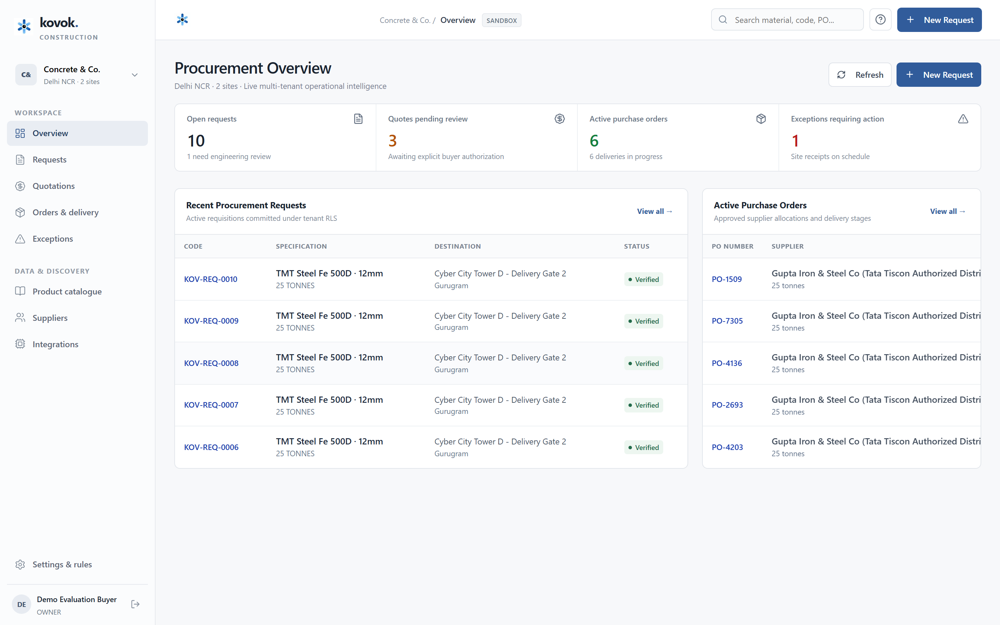

<div align="center">
  
  <h1>Kovok</h1>
  <p><strong>AI-powered construction procurement, from material request to supplier quotation.</strong></p>
</div>

Kovok helps construction teams manage material procurement by organizing requests, identifying suppliers, collecting quotations through AI-assisted voice calls, and supporting buyer review and order tracking.

---

## Product Overview


*Live multi-tenant procurement operations dashboard showing active material requests, quotations pending authorization, and purchase order tracking.*

---

## The Problem

Construction-material procurement in India is highly fragmented, manual, and prone to costly errors:

- **Unstructured Material Requests**: Site engineers often send vague requirements over chat or phone (e.g., "send 10 MT of 12mm rebar") without standard grade specifications, delivery windows, or test certificate requirements.
- **Manual Price Discovery**: Procurement managers must call multiple local distributors, verify stock availability, and collect verbal quotes that change daily based on steel mill and cement plant dispatches.
- **Disparate Commercial Terms**: Quotes arrive with differing commercial baselines—some include 18% or 28% GST, others quote ex-mill prices with freight, unloading, and crane charges added separately.
- **Missing Audit Trails**: Purchase orders are frequently issued over chat or phone without auditable records of quotation comparisons, leading to disputes over delivery weights, rolling tolerances, and off-spec substitutions.

---

## How Kovok Works

```text
[1. Material Request] ──> [2. Catalogue Resolution] ──> [3. Supplier Discovery]
                                                                  │
[6. Orders & Milestones] <── [5. Quote Comparison] <── [4. AI Voice Call Sourcing]
```

1. **Create a project or site and raise a material request**: Define project delivery locations, contacts, and material requirements.
2. **Resolve the material and specification**: The intake engine normalizes buyer descriptions against canonical specifications (e.g., IS 1786 for TMT Steel, IS 269/1489 for Cement) and calculates theoretical quantities and weights. Ambiguous requests route to clarification rather than allowing unverified substitutions.
3. **Identify potential suppliers**: Search and filter regional stockists, verified distributors, and authorized dealers based on material category and delivery capabilities.
4. **Initiate quotation collection via Sarvam Voice**: Dispatch structured AI voice agent calls to candidate suppliers to collect price-per-tonne/bag, freight, unloading terms, and delivery lead times.
5. **Review and compare collected quotations**: Compare normalized commercial offers side by side with full transparency into base rates, taxes, freight, and net landed cost.
6. **Approve and track purchase orders**: Authorize a selected quotation with an explicit buyer approval action, generating a persistent purchase order, delivery milestone timeline, and exception audit log.

---

## What Is Implemented

The application is built as an end-to-end, multi-tenant enterprise procurement system. The table below details what is currently implemented across the stack:

| Module | Implemented UI | Persisted Backend (PostgreSQL 16) | Integration & External Dependencies |
| :--- | :--- | :--- | :--- |
| **Workspace & Authentication** | Login and multi-field workspace registration screens; session handling; role indicators; demo account filler. | Scrypt async hashing; session tokens in database; multi-tenant isolation enforced via PostgreSQL Row-Level Security (RLS). | None. Fully self-contained local authentication engine. |
| **Operational Dashboard** | Live metric cards for open requests, pending quotes, active POs, and open exceptions; recent procurement tables. | Aggregated real-time SQL queries over tenant-scoped tables; dynamic metric refresh. | None. Live database queries. |
| **Projects & Delivery Sites** | Project creation; site address, geo-pinning, primary contact, and default site assignment. | Relational `projects` and `project_sites` tables with workspace foreign keys and default flags. | None. Fully persisted in PostgreSQL. |
| **Material Catalogue & Intake** | 4-step procurement intake wizard; category selection; theoretical steel mass calculations; clarification flagging. | 18 verified canonical products (TMT Steel & Cement); dynamic unit resolution; sequential `KOV-REQ` code generator. | Reference catalogue data seeded locally. |
| **Supplier Directory** | Searchable supplier directory; material category filtering; contact numbers; verified brand distribution badges. | `supplier_organizations` and `catalogue_suppliers` tables linked to verified brand manufacturers. | Illustrative supplier registry for evaluation. |
| **Sarvam Voice Integration** | Supplier call drawer; configuration status check; dial parameter review; explicit dial confirmation guard. | Outbound call payload builder (`/api/procurement/calls`); timing-safe cryptographic webhook handler (`/api/integrations/sarvam/webhook`). | **Requires external credentials**: Valid Sarvam AI Voice Agents API key, registered telephony number, and public HTTPS webhook URL. |
| **Quotation Review & Approval** | Side-by-side quotation comparison table; landed cost breakdown (base rate, freight, unloading, GST); approval action. | Commercial quotes table with status transitions; explicit buyer approval mutation requiring confirmation. | Quotes collected via webhook or created via evaluation intake. |
| **Purchase Orders & Deliveries** | Purchase order detail view; delivery milestone tracker; CSV PO export; checksum verification. | Persistent `purchase_orders` linked to approved quotes; sequential `PO-XXXX` codes; `order_milestones` tracking. | None. Fully persisted and exportable. |
| **Exceptions & Settings** | Exception logging modal (variance, damage, shortfall); required resolution note dialog; workspace settings. | Persistent `procurement_exceptions` table; resolution notes and status transitions; workspace rule updates. | None. Fully persisted in PostgreSQL. |

---

## Demo Status & Boundaries

> **Core Invariant**: The buyer pays the supplier directly. Kovok operates as an intelligence, quotation-collection, and operational layer. The system **never** places orders or commits commercial terms autonomously without explicit buyer authorization.

Please review the following operational boundaries for this release candidate:

1. **Product Demo / Release Candidate**: This codebase is a working release candidate configured for evaluation and demonstration.
2. **Catalogue & Supplier Data**: Supplier contacts, pricing, and availability records in the baseline database are illustrative development fixtures based on canonical BIS/IS specifications.
3. **Live Voice Dialing**: The voice workflow includes complete payload construction, configuration auditing, and callback webhook processing. Placing live telephony calls requires:
   - `SARVAM_API_KEY`: An active Sarvam AI Voice Agents API key.
   - `SARVAM_AGENT_ID`: A configured voice agent identifier.
   - `SARVAM_PHONE_NUMBER_ID`: An approved outbound telephony gateway number.
   - A publicly accessible HTTPS callback URL for incoming call completion webhooks.
   *If these credentials are not set, the application safely prevents dialing, reports the exact missing configuration, and protects against runtime failures.*
4. **Human-in-the-Loop Approval**: Quotation review, commercial trade-offs, and final purchase order issuance always require explicit human buyer confirmation.

---

## Technology Stack

The platform is built using a modern, type-safe full-stack architecture:

- **Next.js 16 (App Router)**: Fast Server Components and Turbopack bundler.
- **React 19**: Responsive client views and interactive procurement modals.
- **TypeScript 5.7+**: Strict type checking across API routes, database models, and UI components.
- **PostgreSQL 16 & Prisma ORM 6**: Relational data model with transaction isolation, composite foreign keys, and PostgreSQL Row-Level Security (`FORCE ROW LEVEL SECURITY`).
- **Sarvam AI Voice Platform**: Conversational voice agent integration for supplier quotation calls in regional Indian languages.
- **Lucide Icons & Design System Tokens**: Enterprise design system without decorative emojis.
- **Testing Infrastructure**: Built-in test suites using `@electric-sql/pglite` (embedded PostgreSQL WASM) and native PostgreSQL integration runners.

---

## Local Run & Verification

### 1. Prerequisites
- **Node.js 24 LTS** (`node -v` >= 24.0.0)
- **npm** (v10+ or v11+)
- **PostgreSQL 16+** (Local service or cloud instance)

### 2. Setup
```bash
# 1. Install dependencies
npm install

# 2. Configure environment
cp .env.example .env
# Edit .env with your local PostgreSQL DATABASE_URL and SESSION_SECRET

# 3. Generate Prisma client & sync schema
npx prisma db push

# 4. Seed reference data (GST tax rules, canonical products, evaluation demo workspace)
npx prisma db seed
```

### 3. Start the Application
```bash
# Development mode
npm run dev

# Or production build & start
npm run build
npm run start
```
Open [http://localhost:3000](http://localhost:3000) in your browser.

### 4. Evaluation Credentials
A pre-seeded demonstration account is available for local review:
- **Email**: `demo@kovok.test`
- **Password**: `DemoEvaluation2026!`
- *Alternatively, use the registration form to provision an independent, isolated workspace.*

### 5. Automated Verification Suites
```bash
# Unit & architecture tests (64 tests across 14 test suites)
npm test

# Real PostgreSQL 16 connection & RLS verification (17 tests)
npm run test:real-postgres

# End-to-end authentication flow verification (5 tests)
npx tsx tests/auth-flows.ts

# Complete release candidate acceptance verification (15 tests)
npx tsx tests/final-acceptance.ts
```

---

## Repository & Development

- **Repository**: [https://github.com/kovok-ai/kovok-bolna](https://github.com/kovok-ai/kovok-bolna)
- **Active Branch**: `phase-2-catalogue-intake`
- **License**: Private / Proprietary — Kovok AI. All rights reserved.
